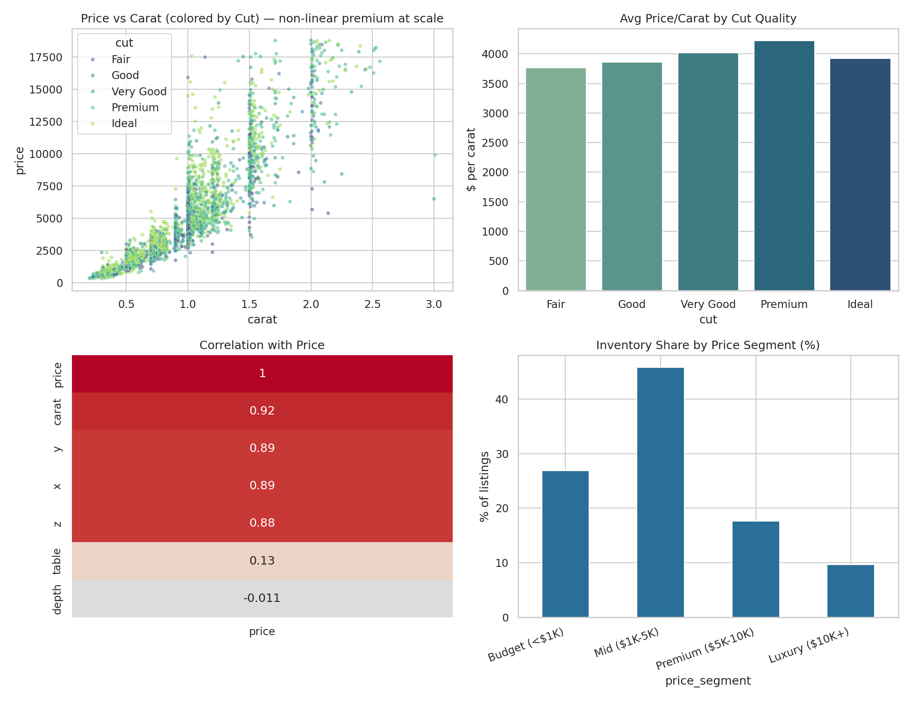

# Diamond Pricing Analytics

Exploratory and predictive analysis of **53,940 real diamond transactions**, framed as a business pricing/inventory problem. Built to demonstrate end-to-end data-analyst workflow: data cleaning, EDA, segmentation, outlier detection, and an interpretable predictive model.

**[View the interactive dashboard →](#)



## Dataset

53,940 diamonds with carat, cut, color, clarity, price, and physical dimensions. Originally published with the `ggplot2` R package (Hadley Wickham); sourced here via [mwaskom/seaborn-data](https://github.com/mwaskom/seaborn-data).

## What this project does

1. **Data cleaning & validation** — removed 24 rows with physically impossible dimensions (e.g. zero-width stones), likely data-entry errors.
2. **Price segmentation** — bucketed inventory into Budget / Mid / Premium / Luxury tiers and quantified each tier's share:

   | Segment | % of inventory | Avg price |
   |---|---|---|
   | Budget (<$1K) | 26.9% | $708 |
   | Mid ($1K–5K) | 45.8% | $2,623 |
   | Premium ($5K–10K) | 17.6% | $6,933 |
   | Luxury ($10K+) | 9.7% | $13,637 |

3. **Price-driver analysis** — correlated price against carat, cut, color, and clarity; carat size dominates (r = 0.92), with clarity and color adding smaller but significant premiums.
4. **Outlier detection** — flagged 2.26% of listings as price/carat outliers using the IQR method within carat bands, useful for catching mispriced or misgraded stones.
5. **Predictive model** — log-linear regression on price using carat, cut, color, clarity, depth, and table.
   - **R² = 0.98** on held-out test data
   - **11.4% mean absolute error**
   - Carat size is by far the strongest driver; clarity and color add measurable secondary premiums.
6. **Interactive dashboard** — 4-panel dashboard (price vs. carat by cut, $/carat by clarity, inventory mix, $/carat by color).

## Tech stack

`Python` · `pandas` · `NumPy` · `scikit-learn` · `matplotlib` / `seaborn` · `Plotly`

## Repo contents

| File | Description |
|---|---|
| `diamond_analysis.py` | Full pipeline: cleaning → EDA → segmentation → outlier detection → regression → exports |
| `diamonds_cleaned.csv` | Cleaned dataset (ready to import into Tableau/Power BI) |
| `eda_summary.png` | Static 4-panel chart summary |
| `diamond_dashboard.html` | Interactive Plotly dashboard (open locally or view via GitHub Pages) |

## Running it locally

```bash
pip install pandas numpy matplotlib seaborn plotly scikit-learn
python diamond_analysis.py
```

Regenerates all charts and the cleaned CSV in the same folder.

## Author

**Kirti** — [github.com/Kirtipassi](https://github.com/Kirtipassi)
